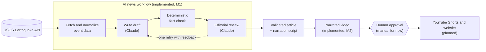
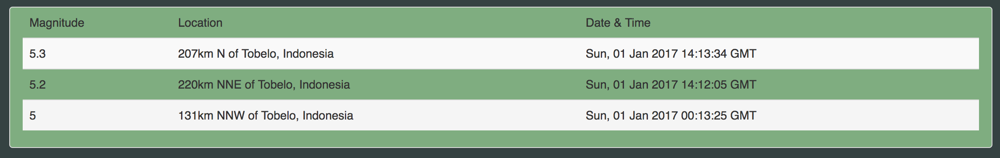

# Next Huge Quake

**From official earthquake data to factual news, and eventually to short narrated videos.**

Next Huge Quake is an evolving open-source project. It turns official earthquake data from the U.S. Geological Survey (USGS) into AI-assisted news articles that are checked against the source data. The long-term goal is a small, transparent publishing pipeline:

1. Detect significant earthquakes.
2. Write accurate English news drafts and narration scripts.
3. Render short narrated videos for social platforms.
4. Publish only after a person approves.

The project began in 2017 as a web app for searching historical earthquakes. That app is still live on [GitHub Pages](https://steffencrespo.github.io/next-huge-quake/).

> **Monitoring, not prediction.** Next Huge Quake reports earthquakes after they happen, using data published by the USGS. It does not predict earthquakes, and nothing in this project should be read as a forecast.

## Features

### Available today

- **Earthquake search website** (2017): search the USGS catalog by date range and minimum magnitude, browse the results, and view event details on a map.
- **AI news drafts (M1):** an [Output.ai](https://docs.output.ai/) workflow that turns one USGS event into:
  - a headline, a one-sentence summary and a 100–150 word article;
  - a 15–30 second narration script for future videos.
- **Fact checking:**
  - Code compares every draft with the USGS data: magnitude, depth, date and time, PAGER alert level, tsunami flag and "Did You Feel It?" report counts.
  - It rejects contradictions and claims the data doesn't support, such as casualties, damage or confirmed tsunamis.
  - An LLM editor also reviews the draft, but its approval can never override a failed fact check.
- **Automatic event selection:** take a specific USGS event ID, or pick the strongest recent earthquake above a configurable magnitude (default 5.5). If nothing qualifies, the workflow returns a clear "no candidate" result instead of an error.

### Implemented since M1 (see [`video/`](video/README.md))

- **Narrated 35-second vertical videos** rendered with Remotion and React: terrain map, data scenes, ElevenLabs narration with the Daniel — Radio news host voice, music and phrase-level captions, plus the full map and music credits.
- **Automatic narration timing:** ElevenLabs returns character-level timestamps, and the captions are built from them.
- **Event to video in one run:** the Output.ai workflow `quake_video` takes a USGS event through M1, then builds the video. It stops with the MP4 ready for review and publishes nothing. It runs with the worker on the host (see [`quake-news-agent/`](quake-news-agent/README.md)).
- Two YouTube Shorts have been **published manually** after human review: the first (Panama, hand-written narration) <https://youtube.com/shorts/8Fwauogd6vY>, and the second (Kamchatka M6.9, narration generated and validated by the M1 workflow) <https://youtube.com/shorts/5YK84uxNRQY>. Both were uploaded by hand; publishing is not automated.

- **USGS monitoring (M5, dry run by default):** the Output.ai workflow `quake_monitor` polls USGS every 5 minutes, deduplicates by event ID, and can start `quake_video` for significant new earthquakes under a daily limit ([ADR 0001](docs/decisions/0001-m5-earthquake-monitoring.md)). It is off for paid production until one fully real, unattended `quake_video` run has succeeded; that has not happened yet.

### Planned

- Human approval before anything is published. Today this is a manual review of the MP4 and its credits.
- Publishing to YouTube Shorts through the API.
- Switching on **paid** autonomous operation of the USGS monitor (see below).
- Showing news and videos on the existing website.

See the [roadmap](#roadmap) for details.

## Architecture



The workflow runs on Temporal through Output.ai. Every step is durable and retried automatically. Each run produces a trace with the USGS request, the LLM prompts and responses, token usage and cost.

### Technology stack

**Implemented in M1**

| Technology | Role |
| --- | --- |
| [Output.ai](https://docs.output.ai/) | Workflow orchestration: steps, prompt files, LLM-as-judge evaluators and run tracing |
| [Temporal](https://docs.temporal.io/) | Durable execution, automatic retries and workflow observability (run locally) |
| [TypeScript](https://www.typescriptlang.org/docs/) and [Node.js](https://nodejs.org/docs/latest/api/) | Backend workflow implementation |
| [Anthropic Claude](https://platform.claude.com/docs/) | Writing structured news drafts and reviewing them editorially |
| [USGS Earthquake Catalog API](https://earthquake.usgs.gov/fdsnws/event/1/) | Official earthquake data |
| [Zod](https://zod.dev/) and [Vitest](https://vitest.dev/) | Schema validation for inputs, outputs and LLM responses; automated tests |
| [Docker](https://docs.docker.com/) | Local development environment (Temporal, PostgreSQL, Redis, worker) |

**Implemented in M2**

| Technology | Role |
| --- | --- |
| [Remotion](https://www.remotion.dev/docs/) and [React](https://react.dev/) | Rendering videos from code |
| [ElevenLabs](https://elevenlabs.io/docs) (M2.4b) | Narration with the Daniel — Radio news host voice, generated automatically with timestamp alignment for captions |

**Planned for future milestones**

| Technology | Role |
| --- | --- |
| [YouTube Data API](https://developers.google.com/youtube/v3) | YouTube Shorts uploads |
| Paid autonomous operation of the monitor | The polling monitor exists (dry run by default); enabling real starts is planned |
| Editorial approval | Human review before any public publication (manual for now) |
| Website integration | Showing published news and videos on the existing site |

The 2017 website is plain HTML, CSS, JavaScript, jQuery and Bootstrap, and it calls the USGS API directly from the browser.

## Roadmap

| Milestone | Scope | Status |
| --- | --- | --- |
| **M1** | USGS earthquake data to a validated English news draft and narration script | Done |
| **M2** | Narrated short videos with Remotion and text-to-speech ([`video/`](video/README.md)) | Videos done (terrain, narration, captions, music); `quake_video` (M2.4d) chains them from a USGS event. Orchestration verified through Temporal with simulated external services; the second Short was made with the same stages run partly by hand. A fully real, unattended run is still pending |
| **M3** | Editorial approval of drafts and videos | Planned |
| **M4** | Publishing approved videos to YouTube Shorts | Planned |
| **M5** | Automated USGS monitoring that starts the video workflow only for eligible events | Implemented, dry run by default; paid autonomous mode waits for a fully real unattended run |
| **M6** | Showing news and videos on the existing website | Planned |

The roadmap may change as the project evolves. Publishing to any public platform will always require human approval.

## Getting started

### The website

The search app is live at **https://steffencrespo.github.io/next-huge-quake/**.

To run it locally, open `index.html` in a browser. There's nothing to build. Enter a minimum magnitude and a date range, then select an earthquake to see its details.



### The AI news workflow

The workflow lives in [`quake-news-agent/`](quake-news-agent/). It needs:

- Node.js 24.15 or later
- Docker Desktop
- an Anthropic API key

Once it's set up, one command runs it:

```bash
npx output workflow run quake_news latest_significant
```

See **[quake-news-agent/README.md](quake-news-agent/README.md)** for setup, credentials, every command, the result format and the fact-checking rules.

## Data, accuracy and limitations

- **Source:** all earthquake data comes from the [USGS Earthquake Hazards Program](https://earthquake.usgs.gov/). Recent events may be preliminary, and the USGS revises magnitudes, locations and other values as it reviews them. Drafts for events that haven't been reviewed must say the figures are preliminary.
- **Estimates, not outcomes:** a [PAGER](https://earthquake.usgs.gov/data/pager/) alert level is a model estimate of possible fatalities or economic losses, not a report of actual impact. Likewise, the USGS tsunami flag only means tsunami information is linked to the event; it doesn't confirm a tsunami. Drafts are checked to describe both this way.
- **Automated checks have limits:** the fact check catches contradictions and unsupported claims it can detect, but it can't guarantee every sentence is correct. For example, it doesn't yet check numbers written out in words. Generated drafts are meant for human editorial review before publication.
- **No forecasting:** the project doesn't predict earthquakes or estimate future risk.
- **Not an official channel:** Next Huge Quake is an independent project and isn't affiliated with the USGS. For safety information, follow official agencies and local authorities.

## Project history

Next Huge Quake started in July 2017 as a front-end project. USGS publishes rich earthquake data, but historical searches weren't easy to run on its site. The app made them simple: pick a date range and a minimum magnitude, see a summary of matching earthquakes, and open details such as the epicenter map, magnitude, depth and PAGER alert level.

The original plan was to forecast the next large earthquake from historical data. That goal has been dropped: reliable earthquake prediction isn't possible with current science. The project has moved toward monitoring, reporting and publishing instead. The 2017 website remains online, unchanged.

## License

Next Huge Quake is released under the [MIT License](LICENSE). The license covers this project's own code and documentation. Third-party data (such as USGS earthquake data), dependencies and assets remain under their own terms.
